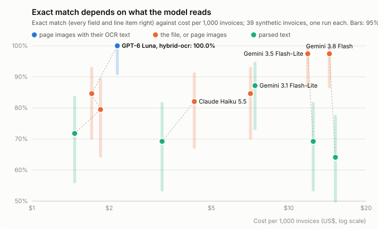

# docfunnel

**A proof of concept. The idea: read a PDF on the CPU first (the text layer, OCR only on scanned pages), so that a cheap LLM can extract its data from text instead of reading the whole file. This repo builds that pipeline, tests the idea against real models and reports what held up and what did not.**

[](https://github.com/gcfialho/docfunnel/actions/workflows/ci.yml)

[](https://docs.astral.sh/uv/)
[](https://docs.astral.sh/ruff/)
[](https://mypy.readthedocs.io/)
[](LICENSE)

## The short version

- **The original idea mostly did not hold.** Parsing first did not make extraction cheaper on Gemini or OpenAI. The answer, not the input, is most of the cost (52 to 92%), and those models read a PDF about as cheaply as its text. It was 25% cheaper on Claude Haiku.
- **On digital PDFs, parsed text was as good as the file.** Every model got all 10 fully digital invoices right.
- **On scanned pages, OCR text alone lost accuracy.** It drops table rows. Two Gemini models did significantly better reading the PDF themselves.
- **A second idea came out of the errors and looks promising.** For scanned pages, send the model the page image *and* its OCR text (`hybrid-ocr`). GPT-6 Luna got 39 of 39 invoices right this way, against 33 sending the PDF (6 to 0 on the invoices where the two differed, p = 0.03), for 26% more cost.
  - That route was designed after looking at errors on these same invoices.
  - It has only been tested on one API model.
  - Until it is run on new and real documents, it is a lead, not a result.
- **The business rules are not a safety net.** They caught dropped line items, but most wrong answers passed them: a misread tax ID, or a dropped row with consistent totals.

The full report states the hypotheses, the method, the statistics, the verdicts and what would confirm them: [Proof of concept: what should an LLM read from a PDF?](docs/evaluation/real-models.md)

<p align="center"></p>

**What the evidence is.**
- **Documents:** 39 invoices made by the repo's own generator, 29 of them with synthetic scans.
- **Runs:** mostly one run per setup. With 39 documents, any single rate is uncertain by 10 to 15 points.
- **Cost:** about US$ 6.50 of API calls.

Every run is in [`reports/e2e/`](reports/e2e/README.md), with intervals and paired tests generated from the raw results. The [lab notebook](docs/evaluation/findings.md) has every run in order, with what it cost and what changed in the code because of it.

## What was built to test it

- **Per-page routing in the parse stage.** Cheap signals from the PDFium text layer send each page to the text layer or to CPU OCR (RapidOCR on ONNX Runtime, Tesseract as a baseline). A digital invoice with one scanned annex gets OCR on that one page.
- **A choice of what the model reads (`route`).**
  - `text`: the parsed text.
  - `native`: the original file.
  - `hybrid`: text, plus an image of each scanned page in place.
  - `hybrid-ocr`: `hybrid`, plus each scanned page's OCR text.
  - The Python API, CLI, HTTP API and MCP server all take it.
- **Pages kept apart.** The unit of work is a page in a process pool. A failure on one page is recorded on that page. Every block keeps its page, character span, bounding box and source.
- **Schema-validated extraction.** Bad model output is repaired or retried, never raised. A fallback model can take over. Business rules (totals, dates, missing items, confidence) send a document to review with machine-readable reasons.
- **Providers.** OpenAI, Anthropic, Gemini and local models on Ollama, through a per-model capability table. An offline `fake` provider and record/replay cassettes let tests and CI run without keys.
- **Evaluations, and the limits of each.**
  - **Parse stage:** CER, field recall and routing accuracy on synthetic PDFs.
  - **LLM step:** the harness's failure handling, measured with the `fake` provider only.
  - **End-to-end:** routes against real models, under a spending cap.
  - **Datasets:** all are generated by seeded scripts, so the labels are right by construction and contain no real or personal data.

## Results

### Real models, end to end

All 39 invoices, one run each, with 95% intervals. All figures are in [`reports/e2e/`](reports/e2e/README.md).

| Model | What the model reads | Exact match | 95% interval | Cost per 1k invoices |
| --- | --- | ---: | ---: | ---: |
| GPT-6 Luna | text, plus image and OCR text of scanned pages (`hybrid-ocr`) | 100% | 91 to 100% | $2.15 |
| GPT-6 Luna | the PDF file (`native`) | 85% | 70 to 93% | $1.71 |
| GPT-6 Luna | parsed text (`text`) | 72% | 56 to 83% | $1.47 |
| Gemini 3.5 Flash-Lite | the PDF file | 97% | 87 to 100% | $11.86 |
| Gemini 3.5 Flash-Lite | parsed text | 69% | 54 to 81% | $12.46 |
| Gemini 3.1 Flash-Lite | parsed text | 87% | 73 to 94% | $7.39 |
| Claude Haiku 5.5 | the PDF file | 82% | 67 to 91% | $4.29 |
| Claude Haiku 5.5 | parsed text | 69% | 54 to 81% | $3.21 |

On 12-invoice samples:
- Claude Sonnet 5.5 got 9 of 12 at $52 per 1,000.
- Gemma 4 12B on a laptop (Ollama) got 8 of 12 on `hybrid-ocr` and 7 on `text`, at minutes per invoice.

### Parse stage

On 50 synthetic PDFs (134 pages), Apple M4 Pro, 12 worker processes. [Full results and discussion →](docs/evaluation/parse-stage.md)

| Pages | Engine | CER | Field recall |
| --- | --- | ---: | ---: |
| digital (78) | text layer | 0.0% | 100.0% |
| scanned light (30) | RapidOCR / Tesseract | 1.6% / 6.0% | 100.0% / 90.7% |
| scanned heavy (26) | RapidOCR / Tesseract | 5.5% / 37.3% | 73.7% / 27.4% |

OCR routing: accuracy 99.3%, precision 98.2%, recall 100.0%. Text extraction runs at about 1,700 pages/s per process; OCR is the bottleneck at 1 to 11 pages/s. The GitHub x86 runner reproduces the quality numbers within the gate's tolerances.

### LLM step, offline

The repair, retry, fallback and review paths are tested with the deterministic `fake` provider, a rule-based stand-in with injected faults. Its numbers describe the harness, not any model. [Details →](docs/evaluation/llm-step.md)

## Quickstart

Requires [uv](https://docs.astral.sh/uv/). Everything below runs offline.

```bash
git clone https://github.com/gcfialho/docfunnel.git && cd docfunnel
uv sync --all-extras                     # or: uv sync --extra cpu  (parse stage only)

uv run docfunnel parse examples/invoice_mixed_scan.pdf
#   p1: text_layer                 source=text_layer blocks=83 ...
#   p2: ocr:scan_with_stray_text   source=ocr        blocks=30 ...
uv run docfunnel parse examples/invoice_mixed_scan.pdf --format markdown

uv run docfunnel extract examples/receipt_us.txt                            # validated JSON + accounting
uv run docfunnel extract examples/receipt_misprinted.txt --fail-on-review   # exit code 3

make gate          # LLM-step eval + regression check against the committed baseline
make gate-parse    # generate the PDF set, run the parse eval, check against the baseline
```

With a real model (keys from the environment, see [`.env.example`](.env.example)):

```bash
export OPENAI_API_KEY=...
uv run docfunnel extract examples/invoice_mixed_scan.pdf --provider openai --route hybrid-ocr
uv run docfunnel extract examples/invoice_br.txt --provider openai --fallback anthropic:claude-haiku-5-5
```

Also available as an HTTP API (`docfunnel serve`) and a Docker image. See the [usage guide](docs/usage.md).

### A worked example: an invoice inbox

[`examples/invoice_inbox.py`](examples/invoice_inbox.py) reads a folder of invoices and receipts, writes the accepted ones to `accepted.csv` and queues the rest in `review.jsonl` with the reasons a person should look at them. It prints what the run cost.

```bash
uv run python examples/invoice_inbox.py examples/          # offline, fake provider
#   accept  invoice_br.txt: Papelaria Estrela, 20053.20 BRL
#   review  invoice_multipage.pdf: line_items_missing:line_items,subtotal
#   review  receipt_misprinted.txt: total_mismatch:subtotal,tax,total
#   5 documents: 3 accepted, 2 sent to review; model cost $0.0000 ...
uv run python examples/invoice_inbox.py ./inbox --provider openai --route hybrid-ocr
```

### From Python

```python
import docfunnel

doc = docfunnel.parse_document("https://example.com/contract.pdf")  # path, URL or bytes
print(doc.pages[0].route, doc.text[:200])

result = docfunnel.extract_document("examples/invoice_mixed_scan.pdf", route="hybrid-ocr")
print(result.document.total, result.needs_review)
```

### From an agent

`docfunnel mcp` is an MCP server with two tools that take a local path or an http(s) URL: `parse_document` (Markdown per page, no LLM call) and `extract_document` (receipt and invoice fields). Downloads are size-capped and private addresses are blocked.

```bash
claude mcp add --transport stdio docfunnel \
  -- uv run --directory /path/to/docfunnel --extra mcp --extra cpu docfunnel mcp
```

Setup for the Claude Agent SDK, the OpenAI Agents SDK, Gemini CLI and LiteLLM: [Using docfunnel from an agent](docs/agents.md).

## How it works


The detailed diagram, the package map and the reasoning behind each design choice are in the [architecture guide](docs/architecture.md).

## Repository layout

```text
src/docfunnel/
├── parse/        # stage 1: PDF/image -> pages and blocks, per-page OCR routing, page pool
├── extract/      # stage 2: schema, normalization, business rules, prompts, extractor, pricing
├── providers/    # OpenAI, Anthropic, Gemini, Ollama, fake, replay; per-model capability table
├── evals/        # parse-stage, LLM-step and end-to-end evals, regression-gate primitives
├── datasets/     # seeded synthetic receipts (text) and invoices/contracts (PDF)
├── library.py  # parse_document / extract_document: path, URL or bytes in
├── inputs.py   # routes: what the model is sent (text, file, page images)
├── sources.py  # local paths, safe downloads, file-type detection
└── cli.py · api.py · mcp_server.py · config.py · loaders.py
tests/            # mirrors src/: parse, extract, providers, evals, datasets, interfaces
docs/             # architecture, usage, providers, evaluation reports, roadmap
reports/baseline/ # committed baselines the CI gates compare against
reports/e2e/      # every real-model run, one folder each, with a generated index
data/synthetic/   # bundled receipt dataset; generated PDFs go to data/synthetic/pdf (git-ignored)
examples/         # sample documents, and invoice_inbox.py: a folder to CSV plus a review queue
```

## Documentation

| Guide | What it covers |
| --- | --- |
| [Architecture](docs/architecture.md) | Pipeline diagram, package map, design choices |
| [Usage](docs/usage.md) | CLI commands, Python API, HTTP API, Docker, MCP, configuration |
| [Agents](docs/agents.md) | MCP tools and setup for Claude Code, the Claude Agent SDK, OpenAI Agents SDK, Gemini CLI, LiteLLM |
| [Providers](docs/providers.md) | Default models, what each adapter sends, pricing, adding a provider |
| [Evaluation: parse stage](docs/evaluation/parse-stage.md) | Dataset, metrics, results across engines and platforms, the gate |
| [Evaluation: LLM step](docs/evaluation/llm-step.md) | The harness's failure handling, measured with the offline `fake` provider (not a model) |
| [Proof-of-concept report](docs/evaluation/real-models.md) | Hypotheses, method, results with intervals and paired tests, verdicts, limits, how to reproduce |
| [Lab notebook](docs/evaluation/findings.md) | Every real-model run in order: what it showed, what it cost, what changed in the code |
| [Limitations and next experiments](docs/roadmap.md) | What the evidence and the code do not cover, and what would settle it |
| [Contributing](CONTRIBUTING.md) | Setup, where code goes, baselines, CI |
| [Changelog](CHANGELOG.md) | What changed between versions |

## Development

```bash
make install   # uv sync --all-extras
make check     # ruff, mypy --strict and the test suite (no network or API keys)
```

CI runs lint, types and tests, both eval gates, and a Docker build with smoke tests. No job needs an API key or a GPU. See [CONTRIBUTING.md](CONTRIBUTING.md).

## Next experiments

In order of cost, to confirm or refute the `hybrid-ocr` result:

1. Run it on a fresh invoice set it was not designed on, three times.
2. Run it on real scans (CORD v2).
3. Run it on Claude and Gemini.
4. Add rules that check answers against the page text, so that consistent but wrong answers stop passing.

The limits of the evidence and of the code are listed in [limitations and next experiments](docs/roadmap.md).

## Author

**Guilherme Fialho**: Data & ML Engineer (GenAI / LLMs). [LinkedIn](https://www.linkedin.com/in/guilherme-cagide-fialho) · [GitHub](https://github.com/gcfialho)

Released under the [MIT License](LICENSE).
