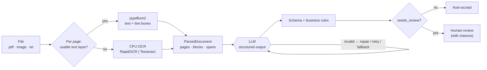

# docfunnel

**A CPU-first document pipeline: parse PDFs and scans page by page, run OCR only where it is needed, then extract validated JSON with an LLM. Every stage has its own evaluation, and CI gates regressions.**

[](https://github.com/gcfialho/docfunnel/actions/workflows/ci.yml)

[](https://docs.astral.sh/uv/)
[](https://docs.astral.sh/ruff/)
[](https://mypy.readthedocs.io/)
[](LICENSE)

Most of the cost of document AI is the LLM call, not the parsing. Reading the text layer of a digital PDF takes milliseconds per page and OCR on a CPU is cheap, so docfunnel does as much as possible before the LLM: get exact text where the PDF has it, OCR only the pages that need it, keep page numbers and character offsets so answers can cite their source, and send the model only what it needs.

## Highlights

- **OCR only where it is needed, decided per page.** Cheap signals from the PDFium text layer route each page to the text layer or to CPU OCR (RapidOCR on ONNX Runtime by default, Tesseract as the baseline), so a digital invoice with one scanned annex gets OCR on that one page only.
- **Page-level process pool.** The unit of work is `(file, page)`; a failure or timeout on one page is recorded on that page without failing the document.
- **Every block is citable.** `ParsedDocument -> Page -> Block` keeps the page number, character span, bounding box and source (`text_layer` or `ocr`) of every line. Output as JSON, text or Markdown.
- **Schema-validated extraction that never raises on bad model output.** Fences and prose are stripped in code, schema errors get a repair turn, transient errors get backoff, and a fallback chain takes over when a model runs out of attempts.
- **Business rules route documents to a human.** Totals that don't add up, implausible dates and low-confidence fields set `needs_review` with machine-readable reasons.
- **Provider-agnostic, with native structured output.** OpenAI, Anthropic and Gemini via a per-model capability table, plus an offline `fake` provider and record/replay cassettes, so CI needs no keys.
- **Measured, not assumed.** Stage-level evals (OCR routing, CER/WER, field recall, throughput; field accuracy, hallucination rate, review precision/recall, cost, latency) with regression gates in CI.
- **No real or personal data.** Both datasets are generated by seeded scripts, so labels are correct by construction.

## Results at a glance

Parse stage on 50 synthetic PDFs (134 pages), Apple M4 Pro, 12 worker processes. [Full results and discussion →](docs/evaluation/parse-stage.md)

| Pages | Engine | CER | Field recall |
| --- | --- | ---: | ---: |
| digital (78) | text layer | 0.0% | 100.0% |
| scanned light (30) | RapidOCR / Tesseract | 1.6% / 6.0% | 100.0% / 90.7% |
| scanned heavy (26) | RapidOCR / Tesseract | 5.5% / 37.3% | 73.7% / 27.4% |

OCR routing: accuracy 99.3%, precision 98.2%, recall 100.0%. Text extraction runs at about 1,700 pages/s per process; OCR is the bottleneck at 1 to 11 pages/s. The GitHub x86 runner reproduces the quality numbers within the gate's tolerances.

LLM step: the harness, repair and fallback paths are verified end to end with the deterministic `fake` provider (100% final schema compliance with a fallback, all misprinted receipts flagged). **No real-model numbers are published yet**; [how to produce them →](docs/evaluation/llm-step.md#reproduce-with-a-real-model)

## Quickstart

Requires [uv](https://docs.astral.sh/uv/). Everything below runs offline.

```bash
git clone https://github.com/gcfialho/docfunnel.git && cd docfunnel
uv sync --all-extras                     # or: uv sync --extra cpu  (parse stage only)

uv run docfunnel parse examples/invoice_mixed_scan.pdf
#   p1: text_layer                 source=text_layer blocks=83 ...
#   p2: ocr:scan_with_stray_text   source=ocr        blocks=30 ...
uv run docfunnel parse examples/invoice_mixed_scan.pdf --format markdown

uv run docfunnel extract examples/receipt_us.txt                            # validated JSON + accounting
uv run docfunnel extract examples/receipt_misprinted.txt --fail-on-review   # exit code 3

make gate          # LLM-step eval + regression check against the committed baseline
make gate-parse    # generate the PDF set, run the parse eval, check against the baseline
```

With a real model (keys from the environment, see [`.env.example`](.env.example)):

```bash
export OPENAI_API_KEY=...
uv run docfunnel extract examples/invoice_br.txt --provider openai --fallback anthropic:claude-haiku-5-5
```

Also available as an HTTP API (`docfunnel serve`), an MCP server (`docfunnel mcp`) and a Docker image. See [docs/usage.md](docs/usage.md).

## How it works



The detailed diagram, the package map and the reasoning behind each design choice are in [docs/architecture.md](docs/architecture.md).

## Repository layout

```text
src/docfunnel/
├── parse/        # stage 1: PDF/image -> pages and blocks, per-page OCR routing, page pool
├── extract/      # stage 2: schema, normalization, business rules, prompts, extractor, pricing
├── providers/    # OpenAI, Anthropic, Gemini, fake, replay; per-model capability table
├── evals/        # parse-stage and LLM-step evals, shared regression-gate primitives
├── datasets/     # seeded synthetic receipts (text) and invoices/contracts (PDF)
└── cli.py · api.py · mcp_server.py · config.py · loaders.py
tests/            # mirrors src/: parse, extract, providers, evals, datasets, interfaces
docs/             # architecture, usage, providers, evaluation reports, roadmap
reports/baseline/ # committed baselines the CI gates compare against
data/synthetic/   # bundled receipt dataset; generated PDFs go to data/synthetic/pdf (git-ignored)
examples/         # sample documents for the quickstart
```

## Documentation

| | |
| --- | --- |
| [Architecture](docs/architecture.md) | Pipeline diagram, package map, design choices |
| [Usage](docs/usage.md) | CLI commands, HTTP API, Docker, MCP, configuration |
| [Providers](docs/providers.md) | Default models, what each adapter sends, pricing, adding a provider |
| [Evaluation: parse stage](docs/evaluation/parse-stage.md) | Dataset, metrics, results across engines and platforms, the gate |
| [Evaluation: LLM step](docs/evaluation/llm-step.md) | Dataset, metrics, fake-provider results, reproducing with a real model |
| [Roadmap](docs/roadmap.md) | Known limitations and the next phases |
| [Contributing](CONTRIBUTING.md) | Setup, where code goes, baselines, CI |
| [Changelog](CHANGELOG.md) | What changed between versions |

## Development

```bash
make install   # uv sync --all-extras
make check     # ruff + mypy --strict + 267 tests (~10 s, no network or API keys, 96% coverage)
```

CI runs lint, types and tests, both eval gates, and a Docker build with smoke tests. No job needs an API key or a GPU. See [CONTRIBUTING.md](CONTRIBUTING.md).

## Roadmap

Phase 1 (this version) is the parse stage and its evaluation, feeding the LLM extraction step. Next: **classification and retrieval** (cascade classifier, layout-aware chunking, hybrid search, CORD v2 and olmOCR-bench subsets), then **QA with verified citations** (evidence inside the schema, checked in code, with a quality-vs-cost Pareto across models), and optionally a **GPU benchmark** to find which pages justify a GPU route. Details and current limitations: [docs/roadmap.md](docs/roadmap.md).

## Author

**Guilherme Fialho**: Data & ML Engineer (GenAI / LLMs). [LinkedIn](https://www.linkedin.com/in/guilherme-cagide-fialho) · [GitHub](https://github.com/gcfialho)

Released under the [MIT License](LICENSE).
