# docfunnel

**A document pipeline that decides, page by page, what the LLM sees: the text layer where a PDF has one, the page image plus its OCR text where it does not. Then validated JSON, with business rules that send doubtful answers to a human. Every stage is measured, against real models too.**

[](https://github.com/gcfialho/docfunnel/actions/workflows/ci.yml)

[](https://docs.astral.sh/uv/)
[](https://docs.astral.sh/ruff/)
[](https://mypy.readthedocs.io/)
[](LICENSE)

Reading the text layer of a digital PDF takes milliseconds per page, and it is exact. Scanned pages are different: OCR text loses table rows, and a model reading the image misreads identifiers. docfunnel parses every page on the CPU, then sends the model the text where the PDF has it and, for a scanned page, its image together with its OCR text. In runs against real models, that made the cheapest API model tested as accurate as the best one, at a fraction of the cost ([results](#results-at-a-glance)).

## Highlights

- **The model sees what each page needs.** Four routes: parsed text, the original file, or text plus an image of each scanned page in place, with or without that page's OCR text (`hybrid-ocr`, the most accurate in our runs). Python API, CLI, HTTP API and MCP all take `route`.
- **OCR only where it is needed, decided per page.** Cheap signals from the PDFium text layer route each page to the text layer or to CPU OCR (RapidOCR on ONNX Runtime by default, Tesseract as the baseline), so a digital invoice with one scanned annex gets OCR on that one page only.
- **Page-level process pool.** The unit of work is `(file, page)`; a failure or timeout on one page is recorded on that page without failing the document.
- **Every block is citable.** `ParsedDocument -> Page -> Block` keeps the page number, character span, bounding box and source (`text_layer` or `ocr`) of every line. Output as JSON, text or Markdown.
- **Schema-validated extraction that never raises on bad model output.** Fences and prose are stripped in code, schema errors get a repair turn, transient errors get backoff, and a fallback chain takes over when a model runs out of attempts.
- **Business rules route documents to a human.** Totals that don't add up, implausible dates and low-confidence fields set `needs_review` with machine-readable reasons.
- **Provider-agnostic, with native structured output and file input.** OpenAI, Anthropic, Gemini and local models on Ollama via a per-model capability table, plus an offline `fake` provider and record/replay cassettes, so CI needs no keys.
- **Measured, not assumed.** Stage-level evals (OCR routing, CER/WER, field recall, throughput; field accuracy, hallucination rate, review precision/recall, cost, latency) with regression gates in CI, and an end-to-end eval that runs every route against real models under a spending cap.
- **No real or personal data.** Both datasets are generated by seeded scripts, so labels are correct by construction.

## Results at a glance

End to end with real models, on 39 synthetic invoices of 1 to 10 pages (29 with scanned pages). Exact match means every header field and every line item right. [Lab notebook with every run, its cost and what changed because of it →](docs/evaluation/findings.md)

| Model | What the model sees | Exact match | Cost per 1k invoices |
| --- | --- | ---: | ---: |
| GPT-6 Luna | **text, plus image and OCR text of scanned pages** (`hybrid-ocr`) | **100%** (repeat: 97%) | **$2.15** |
| GPT-6 Luna | the PDF file | 85% | $1.71 |
| GPT-6 Luna | parsed text only | 72 to 74% | $1.47 to $1.68 |
| Gemini 3.5 Flash-Lite | the PDF file | 97% | $11.86 |
| Gemini 3.1 Flash-Lite | text, plus image of scanned pages (`hybrid`) | ~97% | ~$7.3 |
| Claude Haiku 5.5 | the PDF file | 82% | $4.29 |
| Claude Sonnet 5.5, 12-invoice sample | the PDF file | 75% | $52 |
| Gemma 4 12B on a laptop (Ollama), 12-invoice sample | `hybrid-ocr` | 67% | $0 API, ~6 min each |

What the runs showed: output tokens are 72 to 92% of the cost, so sending less text saves little on Gemini and OpenAI, which read PDFs cheaply (it does save 25 to 63% on Claude). The gain is in accuracy on scans: OCR text keeps identifiers right, the image keeps table rows right, and together they fixed both. A bigger model did not help. These are single runs on synthetic documents (run-to-run variance ~10 pp), and `hybrid-ocr` has not been run on Claude or Gemini yet.

Parse stage on 50 synthetic PDFs (134 pages), Apple M4 Pro, 12 worker processes. [Full results and discussion →](docs/evaluation/parse-stage.md)

| Pages | Engine | CER | Field recall |
| --- | --- | ---: | ---: |
| digital (78) | text layer | 0.0% | 100.0% |
| scanned light (30) | RapidOCR / Tesseract | 1.6% / 6.0% | 100.0% / 90.7% |
| scanned heavy (26) | RapidOCR / Tesseract | 5.5% / 37.3% | 73.7% / 27.4% |

OCR routing: accuracy 99.3%, precision 98.2%, recall 100.0%. Text extraction runs at about 1,700 pages/s per process; OCR is the bottleneck at 1 to 11 pages/s. The GitHub x86 runner reproduces the quality numbers within the gate's tolerances.

LLM step offline: the harness, repair and fallback paths are verified end to end with the deterministic `fake` provider (100% final schema compliance with a fallback, all misprinted receipts flagged). [Details →](docs/evaluation/llm-step.md)

## Quickstart

Requires [uv](https://docs.astral.sh/uv/). Everything below runs offline.

```bash
git clone https://github.com/gcfialho/docfunnel.git && cd docfunnel
uv sync --all-extras                     # or: uv sync --extra cpu  (parse stage only)

uv run docfunnel parse examples/invoice_mixed_scan.pdf
#   p1: text_layer                 source=text_layer blocks=83 ...
#   p2: ocr:scan_with_stray_text   source=ocr        blocks=30 ...
uv run docfunnel parse examples/invoice_mixed_scan.pdf --format markdown

uv run docfunnel extract examples/receipt_us.txt                            # validated JSON + accounting
uv run docfunnel extract examples/receipt_misprinted.txt --fail-on-review   # exit code 3

make gate          # LLM-step eval + regression check against the committed baseline
make gate-parse    # generate the PDF set, run the parse eval, check against the baseline
```

With a real model (keys from the environment, see [`.env.example`](.env.example)):

```bash
export OPENAI_API_KEY=...
uv run docfunnel extract examples/invoice_mixed_scan.pdf --provider openai --route hybrid-ocr
uv run docfunnel extract examples/invoice_br.txt --provider openai --fallback anthropic:claude-haiku-5-5
```

Also available as an HTTP API (`docfunnel serve`) and a Docker image. See the [usage guide](docs/usage.md).

### From Python

```python
import docfunnel

doc = docfunnel.parse_document("https://example.com/contract.pdf")  # path, URL or bytes
print(doc.pages[0].route, doc.text[:200])

result = docfunnel.extract_document("examples/invoice_mixed_scan.pdf", route="hybrid-ocr")
print(result.document.total, result.needs_review)
```

### From an agent

`docfunnel mcp` is an MCP server with two tools that take a local path or an http(s) URL: `parse_document` (Markdown per page, no LLM call) and `extract_document` (receipt and invoice fields). Downloads are size-capped and private addresses are blocked.

```bash
claude mcp add --transport stdio docfunnel \
  -- uv run --directory /path/to/docfunnel --extra mcp --extra cpu docfunnel mcp
```

Setup for the Claude Agent SDK, the OpenAI Agents SDK, Gemini CLI and LiteLLM: [Using docfunnel from an agent](docs/agents.md).

## How it works

```mermaid
---
config:
  theme: base
  themeVariables:
    fontSize: 14px
    primaryColor: "#ffffff"
    primaryBorderColor: "#94a3b8"
    primaryTextColor: "#0f172a"
    lineColor: "#64748b"
    clusterBkg: "#f8fafc"
    clusterBorder: "#cbd5e1"
    titleColor: "#0f172a"
    edgeLabelBackground: "#ffffff"
  flowchart:
    curve: basis
    nodeSpacing: 40
    rankSpacing: 50
    padding: 12
---
flowchart LR
    IN[/"PDF · image · text"/]

    subgraph S1["Stage 1 · Parse (CPU, no LLM)"]
        ROUTE{"Usable<br/>text layer?"}
        TEXT["Text layer<br/>pypdfium2"]
        OCR["CPU OCR<br/>RapidOCR · Tesseract"]
        DOC[("ParsedDocument<br/>pages · blocks · spans")]
        IMG["Page image<br/>scanned pages"]
        ROUTE -->|yes| TEXT --> DOC
        ROUTE -->|no| OCR --> DOC
        ROUTE -->|no| IMG
    end

    subgraph S2["Stage 2 · LLM extraction"]
        LLM{{"LLM<br/>structured output"}}
        SCHEMA{"Valid<br/>schema?"}
        RULES{"Business<br/>rules?"}
        LLM --> SCHEMA
        SCHEMA -->|"no · repair, retry,<br/>fallback"| LLM
        SCHEMA -->|yes| RULES
    end

    IN --> ROUTE
    DOC --> LLM
    IMG -.->|"hybrid routes"| LLM
    RULES -->|pass| ACCEPT(["Auto-accept"])
    RULES -->|fail| REVIEW(["Human review<br/>with reasons"])

    classDef io fill:#f1f5f9,stroke:#475569,stroke-width:1.5px,color:#0f172a
    classDef parse fill:#eff6ff,stroke:#3b82f6,stroke-width:1.5px,color:#0f172a
    classDef llm fill:#f5f3ff,stroke:#7c3aed,stroke-width:1.5px,color:#0f172a
    classDef decision fill:#ffffff,stroke:#334155,stroke-width:1.5px,color:#0f172a
    classDef data fill:#ecfeff,stroke:#0891b2,stroke-width:1.5px,color:#0f172a
    classDef ok fill:#f0fdf4,stroke:#16a34a,stroke-width:2px,color:#14532d
    classDef warn fill:#fff7ed,stroke:#ea580c,stroke-width:2px,color:#7c2d12
    style S1 fill:#f8fafc,stroke:#93c5fd,stroke-width:1.5px,color:#1e3a8a
    style S2 fill:#f8fafc,stroke:#c4b5fd,stroke-width:1.5px,color:#4c1d95
    class IN io
    class TEXT,OCR,IMG parse
    class LLM llm
    class ROUTE,SCHEMA,RULES decision
    class DOC data
    class ACCEPT ok
    class REVIEW warn
```



The detailed diagram, the package map and the reasoning behind each design choice are in the [architecture guide](docs/architecture.md).

## Repository layout

```text
src/docfunnel/
├── parse/        # stage 1: PDF/image -> pages and blocks, per-page OCR routing, page pool
├── extract/      # stage 2: schema, normalization, business rules, prompts, extractor, pricing
├── providers/    # OpenAI, Anthropic, Gemini, Ollama, fake, replay; per-model capability table
├── evals/        # parse-stage, LLM-step and end-to-end evals, regression-gate primitives
├── datasets/     # seeded synthetic receipts (text) and invoices/contracts (PDF)
├── library.py  # parse_document / extract_document: path, URL or bytes in
├── inputs.py   # routes: what the model is sent (text, file, page images)
├── sources.py  # local paths, safe downloads, file-type detection
└── cli.py · api.py · mcp_server.py · config.py · loaders.py
tests/            # mirrors src/: parse, extract, providers, evals, datasets, interfaces
docs/             # architecture, usage, providers, evaluation reports, roadmap
reports/baseline/ # committed baselines the CI gates compare against
data/synthetic/   # bundled receipt dataset; generated PDFs go to data/synthetic/pdf (git-ignored)
examples/         # sample documents for the quickstart
```

## Documentation

| Guide | What it covers |
| --- | --- |
| [Architecture](docs/architecture.md) | Pipeline diagram, package map, design choices |
| [Usage](docs/usage.md) | CLI commands, Python API, HTTP API, Docker, MCP, configuration |
| [Agents](docs/agents.md) | MCP tools and setup for Claude Code, the Claude Agent SDK, OpenAI Agents SDK, Gemini CLI, LiteLLM |
| [Providers](docs/providers.md) | Default models, what each adapter sends, pricing, adding a provider |
| [Evaluation: parse stage](docs/evaluation/parse-stage.md) | Dataset, metrics, results across engines and platforms, the gate |
| [Evaluation: LLM step](docs/evaluation/llm-step.md) | Dataset, metrics, fake-provider results, reproducing with a real model |
| [Evaluation: real models](docs/evaluation/findings.md) | End-to-end runs on GPT, Claude, Gemini and a local model: routes, accuracy, cost |
| [Roadmap](docs/roadmap.md) | Known limitations and the next phases |
| [Contributing](CONTRIBUTING.md) | Setup, where code goes, baselines, CI |
| [Changelog](CHANGELOG.md) | What changed between versions |

## Development

```bash
make install   # uv sync --all-extras
make check     # ruff, mypy --strict and the test suite (no network or API keys)
```

CI runs lint, types and tests, both eval gates, and a Docker build with smoke tests. No job needs an API key or a GPU. See [CONTRIBUTING.md](CONTRIBUTING.md).

## Roadmap

Phase 1 (this version) is the parse stage and its evaluation, feeding the LLM step. Next: **classification and retrieval** (cascade classifier, layout-aware chunking, hybrid search, CORD v2 and olmOCR-bench subsets), then **QA with verified citations** (evidence inside the schema, checked in code, with a quality-vs-cost Pareto across models), and optionally a **GPU benchmark** to find which pages justify a GPU route. Details and current limitations are in the [roadmap](docs/roadmap.md).

## Author

**Guilherme Fialho**: Data & ML Engineer (GenAI / LLMs). [LinkedIn](https://www.linkedin.com/in/guilherme-cagide-fialho) · [GitHub](https://github.com/gcfialho)

Released under the [MIT License](LICENSE).
