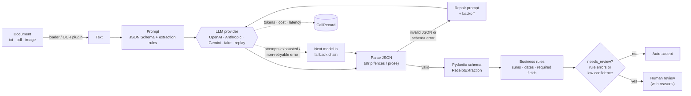

# docfunnel

*Previously named `llm-document-extraction-evals`.*

**Production-style LLM extraction of receipts and invoices into validated JSON, with retries, model fallback, human-review routing, cost/latency tracking, and an evaluation harness that gates regressions in CI.**

[](https://github.com/gcfialho/docfunnel/actions/workflows/ci.yml)

[](https://docs.astral.sh/uv/)
[](https://docs.astral.sh/ruff/)
[](LICENSE)

Getting an LLM to return JSON for a demo takes minutes. Running it in production takes more work: the output has to be checked against a schema and against business rules, bad answers need repairing, outages need a fallback, documents the system is unsure about have to go to a person, and you need a way to tell whether a prompt or model change made things better or worse. This repository covers that part, using receipts and invoices as the domain.

## Highlights

- **Schema-constrained extraction.** A Pydantic contract (`ReceiptExtraction`) covers vendor, tax ID, document number, date, currency, subtotal, tax, total, payment method and line items, plus a confidence score for each field. Money is stored as `Decimal`, and inputs like `"1.234,50 €"`, `"R$ 15.120,00"` and `"15/03/2024"` are normalized.
- **Business-rule validation.** Line items must sum to the subtotal, subtotal plus tax must equal the total, quantity times unit price must equal the line total, dates must be plausible, and required fields must be present. Each result comes back with a `needs_review` flag and machine-readable reasons such as `total_mismatch:subtotal,tax,total` or `low_confidence:date`.
- **Failure handling, cheapest fix first.** Markdown fences and surrounding prose are stripped in code. Invalid JSON or a schema error triggers a repair prompt that includes the exact validation errors. Rate limits and 5xx errors are retried with exponential backoff and jitter. Once a model has used up its attempts, a fallback chain takes over. The pipeline never raises on bad model output.
- **Provider-agnostic.** OpenAI, Anthropic and Gemini can be selected with environment variables or CLI flags. There is also a deterministic offline `fake` provider and a record/replay cassette provider, so CI needs no API keys or network.
- **Cost and latency per call.** Every call records tokens, USD cost from a configurable price table, latency, attempt number and purpose (`extract` or `repair`). Reports aggregate p50 and p95 latency.
- **Evaluation harness.** Scores field-level accuracy with normalization, document exact match, schema compliance (first attempt and final), hallucination rate, line-item F1, review-flag precision and recall, retry and fallback rates, cost and latency. It breaks results down by layout, locale and noise, and writes a JSON and a Markdown report.
- **Regression gate.** `docfunnel compare baseline.json candidate.json` exits non-zero when quality drops or cost rises beyond configurable thresholds. CI runs it on every push.
- **Several ways in.** A CLI (`extract`, `eval`, `compare`), a FastAPI service (`POST /extract`), an MCP server exposing an `extract_document` tool, and a Docker image.
- **No real or personal data.** The 60-document labelled dataset is generated by a seeded script, so the labels are correct by construction and there are no licensing questions.

## Quickstart

Requires [uv](https://docs.astral.sh/uv/). The steps below work offline with the fake provider.

```bash
git clone https://github.com/gcfialho/docfunnel.git
cd docfunnel
uv sync --all-extras

# Extract one document (prints validated JSON, review decision and per-call accounting)
uv run docfunnel extract examples/receipt_us.txt
uv run docfunnel extract examples/receipt_misprinted.txt --fail-on-review   # exit code 3

# Evaluate on the labelled dataset -> reports/latest/report.{json,md}
uv run docfunnel eval --fallback fake:fake-pro

# Regression check against the committed baseline
uv run docfunnel compare reports/baseline/fake-mini+fallback/report.json reports/latest/report.json
```

With a real model (keys are read from the environment; see [`.env.example`](.env.example)):

```bash
export OPENAI_API_KEY=...
uv run docfunnel extract examples/invoice_br.txt \
  --provider openai --model gpt-4o-mini \
  --fallback anthropic:claude-haiku-4-5
```

**HTTP API**

```bash
uv run docfunnel serve            # OpenAPI docs at http://127.0.0.1:8000/docs
curl -s localhost:8000/extract -H 'content-type: application/json' \
  -d "{\"text\": $(jq -Rs . < examples/receipt_us.txt)}"
```

`POST /extract` accepts `{"text": ...}` or `{"path": ...}`. Path input (txt, PDF with a text layer, or an image through the optional Tesseract loader) only works inside the directory set by `DOCFUNNEL_INPUT_DIR` and is disabled by default.

**Docker**

```bash
docker build -t docfunnel .
docker run --rm -p 8000:8000 docfunnel                     # fake provider
docker run --rm -p 8000:8000 -e DOCFUNNEL_PROVIDER=openai -e OPENAI_API_KEY docfunnel
```

**MCP server** (stdio), for example in an MCP client config:

```json
{
  "mcpServers": {
    "docfunnel": {
      "command": "uv",
      "args": ["run", "--directory", "/path/to/docfunnel",
               "--extra", "mcp", "docfunnel", "mcp"],
      "env": { "DOCFUNNEL_PROVIDER": "anthropic", "ANTHROPIC_API_KEY": "..." }
    }
  }
}
```

## How it works



Design choices:

- **Problems with the answer get retried. Problems with the document go to review.** A schema error means the model made a mistake, so it gets a repair turn. A total that doesn't add up may be what's actually printed on the page, so retrying won't help. That case goes to a human with the reason attached.
- **Every field is nullable.** The prompt tells the model to return `null` for anything not printed. Without that option, the schema would push the model to invent values. Allowing null also makes hallucination measurable: a value returned where the label is null counts as a hallucinated field.
- **Normalization is shared.** `docfunnel.normalize` is the single definition of when two values are equal. Schema coercion, business rules and eval metrics all use it, so `"1.234,50"` and `1234.5` are treated the same everywhere.
- **SDK-level retries are disabled.** The extractor controls the retry policy, so every attempt shows up in the accounting.

## Evaluation

### Dataset

`data/synthetic/receipts.jsonl` contains 60 documents generated by `docfunnel generate-dataset` (seeded; a test checks that the committed file matches the generator). It covers:

| Dimension | Values |
| --- | --- |
| Locales | US (USD, `MM/DD/YYYY`), UK (GBP, VAT), DE (EUR, decimal comma, MwSt), BR (BRL, CNPJ, Pix) |
| Layouts | thermal POS receipt (30), tabular invoice (19), minimal ticket (11) |
| Variants | clean (45), OCR noise such as `T0TAL` or `1O,5O` (8), misprinted totals that *should* be reviewed (7) |
| Hard cases | absent optional fields (tax ID, number, tax, payment), a "Bill to" customer next to the vendor, thousands separators |

### Metrics

| Metric | Definition |
| --- | --- |
| Field accuracy | Share of (document, field) pairs that are right after normalization, over 9 header fields. "Both null" counts as right. |
| Document exact match | All header fields right and line items matched one-to-one (description fuzzy ≥ 0.8, quantity and total exact). |
| Schema compliance | Share of documents that end with a schema-valid result. "First attempt" is the same measure before repair or fallback. |
| Hallucination rate | `hallucinated / (hallucinated + true nulls)`: how often a field that is *not* on the document gets a value. |
| Review precision / recall | Measured against `should_review = misprinted document OR extraction has any error`. |
| Cost, latency | Sum of per-call costs from the price table. p50 and p95 of end-to-end latency per document. |

### Results: fake provider only (not a real model)

> **Read this first.** The numbers below were produced by running the harness with the **deterministic `fake` provider**. That provider is a regex parser written for these templates, with **fault injection**: malformed JSON, schema violations, hard failures and confident hallucinations, each at a fixed rate. The numbers show that the harness and the failure handling work end to end. **They say nothing about how any LLM performs.** No real-model results are published here; to get them, use the commands under "Reproduce with a real model" below.

Command: `uv run docfunnel eval --provider fake --model fake-mini [--fallback fake:fake-pro]` (reports in [`reports/baseline/`](reports/baseline/)).

| Metric | `fake-mini` | `fake-mini` with `fake-pro` fallback |
| --- | ---: | ---: |
| Documents | 60 | 60 |
| Field accuracy (9 header fields) | 96.7% | 98.1% |
| Document exact match | 88.3% | 90.0% |
| Schema compliance, first attempt | 83.3% | 83.3% |
| Schema compliance, final | 98.3% | **100.0%** |
| Hallucination rate | 1.7% | 1.7% |
| Line items F1 | 98.0% | 100.0% |
| Review flag rate | 16.7% | 15.0% |
| Review precision / recall | 100.0% / 71.4% | 100.0% / 69.2% |
| Docs needing a retry / fallback | 16.7% / 0.0% | 16.7% / 1.7% |
| Tokens (input / output) | 63,199 / 8,688 | 64,109 / 8,889 |
| Cost | $0 (fake models are priced at $0) | $0 |
| Latency p50 / p95 | 0.2 / 0.3 ms (harness overhead only) | 0.2 / 0.3 ms |

What the run shows about the system (not about any model):

- **Repair works.** 10 of 60 first answers (16.7%) were malformed or broke the schema. A repair turn fixed every one except the single document where the primary model always fails, and the fallback model recovered that one.
- **Errors cluster where expected.** Clean documents reach 99.8% field accuracy. OCR-noised ones drop to 87.5% field accuracy and 37.5% exact match. Those slices are in the per-run `report.md`.
- **Business rules catch what confidence can't.** All 7 misprinted receipts are flagged (`total_mismatch` or `line_items_total_mismatch`) even though the extraction itself was correct.
- **Review recall is about 70%, and the misses are the useful finding.** They are *confident* hallucinations (for example, an invented `tax` of 1.00 with confidence 0.85 on a minimal ticket that prints only a total) and quietly missed optional fields. Self-reported confidence doesn't catch these. Measuring hallucination against labels, and keeping rules that cross-check fields, is how you find them.

Example regression gate output, comparing the no-fallback run against the baseline (`docfunnel compare`, exit code 1):

```text
| Metric                   | Baseline | Candidate |   Delta | Tolerance | Status     |
| field_accuracy           |    98.1% |     96.7% | -1.5 pp |    1.0 pp | REGRESSION |
| schema_compliance_rate   |   100.0% |     98.3% | -1.7 pp |    0.0 pp | REGRESSION |
| hallucination_rate       |     1.7% |      1.7% | +0.0 pp |    1.0 pp | pass       |
| ...                                                                                 |
```

### Reproduce with a real model

```bash
uv sync --all-extras
export OPENAI_API_KEY=...            # or ANTHROPIC_API_KEY / GEMINI_API_KEY
uv run docfunnel eval --provider openai --model gpt-4o-mini \
  --out reports/openai-gpt-4o-mini --workers 4 \
  --record cassettes/gpt-4o-mini.json        # keep every response for offline re-scoring

# Re-score later with no network or cost, e.g. after changing a metric:
uv run docfunnel eval --provider replay --model gpt-4o-mini \
  --cassette cassettes/gpt-4o-mini.json --out reports/replay

# Gate a prompt/model change:
uv run docfunnel compare reports/openai-gpt-4o-mini/report.json reports/candidate/report.json \
  --max-cost-increase 0.10 --max-p95-latency-increase 0.25
```

Prices come from [`src/docfunnel/pricing.json`](src/docfunnel/pricing.json) (USD per 1M tokens). They are illustrative list prices: check them against the provider's current pricing, or point `DOCFUNNEL_PRICING_FILE` at your own table. Models missing from the table are reported with cost "unknown", never as $0.

## Project structure

```text
src/docfunnel/
├── schema.py            # Pydantic contracts: ReceiptExtraction, ExtractionResult, CallRecord
├── normalize.py         # amounts, dates, currencies, identifiers: one definition of "equal"
├── validation.py        # business rules + needs_review decision
├── prompts.py           # system / user / repair prompts, tolerant JSON parsing
├── extractor.py         # retry -> repair -> fallback loop, cost & latency accounting
├── pricing.py/.json     # configurable price table
├── config.py            # env-driven settings, extractor factory
├── providers/           # openai, anthropic, gemini, fake (offline), replay/record cassettes
├── evals/               # dataset, metrics, runner, JSON/Markdown reports, regression compare
├── synthetic.py         # seeded receipt/invoice generator with ground truth
├── loaders.py           # txt / pdf (pypdf) / image (tesseract) - pluggable
├── api.py               # FastAPI app
├── mcp_server.py        # MCP server with the extract_document tool
└── cli.py               # docfunnel extract | eval | compare | generate-dataset | serve | mcp
data/synthetic/          # bundled labelled dataset (generated)
reports/baseline/        # committed fake-provider baselines used by the CI gate
examples/                # sample documents for the quickstart
tests/                   # unit, integration (fake provider), API, CLI, MCP, SDK-adapter tests
```

## Testing

```bash
uv run pytest                      # 177 tests, about 2 s, no network or API keys
uv run pytest --cov=docfunnel     # about 96% line coverage
uv run ruff check . && uv run ruff format --check .
```

- **Unit:** normalization edge cases (separators, locales, ambiguous dates), schema coercion and rejection, every business rule, JSON parsing, metrics (field outcomes, one-to-one line-item matching, percentiles), price lookup.
- **Extractor:** a scripted provider drives the repair, backoff, transient-error retry, fallback, total-failure and cost-accounting paths.
- **Provider adapters:** OpenAI, Anthropic and Gemini adapters are tested against stubbed SDK clients (request mapping, token usage, retryable or non-retryable classification) with no network.
- **Integration:** the full eval through the fake provider (determinism, fallback effect, report round-trip, regression detection), the FastAPI app via `TestClient`, the CLI via `CliRunner`, and the MCP tool via `list_tools` and `call_tool`.

CI ([`.github/workflows/ci.yml`](.github/workflows/ci.yml)) runs lint and tests, then the **eval regression gate** against the committed baseline (the comparison goes to the job summary), then a Docker build and smoke test.

## Limitations & roadmap

- **Synthetic data is easier than real scans.** The layouts are regular, and the fake provider was written for them. Next step: score real models on a small, properly licensed public sample (for example CORD or SROIE, after checking their terms) next to the synthetic set.
- **Text first.** Images go through basic Tesseract OCR, and PDFs need a text layer. Planned: send page images straight to vision-capable models and compare against OCR plus text.
- **Prompt-and-validate structured output.** This works the same way across providers. Native strict modes (OpenAI `json_schema`, Anthropic structured outputs, Gemini `response_schema`) would cut repair turns and are next on the list.
- **Uncalibrated confidence.** Per-field confidence is self-reported. Planned: calibration on labelled data (reliability curves) and threshold tuning per field.
- **Domain coverage.** Discounts, tips, multiple tax rates per document and multi-page invoices aren't modelled yet.
- **Throughput.** The extractor is synchronous with a thread-pool option for evals. Async clients, provider batch APIs and response caching are not implemented.
- **Review is a flag.** There is no review UI or queue. The API returns the decision and the reasons for a downstream workflow to act on.

## Author

**Guilherme Fialho**: Data & ML Engineer (GenAI / LLMs). [LinkedIn](https://www.linkedin.com/in/guilherme-cagide-fialho) · [GitHub](https://github.com/gcfialho)

Released under the [MIT License](LICENSE).
