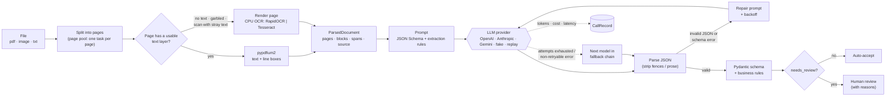

# docfunnel

*Previously named `llm-document-extraction-evals`.*

**A CPU-first document pipeline: parse PDFs and scans page by page, run OCR only where it is needed, then extract validated JSON with an LLM. Every stage has its own evaluation, and CI gates regressions.**

[](https://github.com/gcfialho/docfunnel/actions/workflows/ci.yml)

[](https://docs.astral.sh/uv/)
[](https://docs.astral.sh/ruff/)
[](https://mypy.readthedocs.io/)
[](LICENSE)

Most of the cost of document AI is the LLM call, not the parsing. Reading the text layer of a digital PDF takes milliseconds per page and OCR on a CPU is cheap, so the plan is to do as much as possible before the LLM: get exact text where the PDF has it, OCR only the pages that need it, keep page numbers and character offsets so answers can cite their source, and send the model only what it needs. This repository builds that pipeline in stages. Phase 1, implemented here, is the parse stage and its evaluation; it feeds the LLM extraction step that already handles schema validation, repair, fallback, human-review routing and cost tracking. The [roadmap](#limitations--roadmap) lists the next stages (classification, retrieval, question answering with verified citations).

## Highlights

- **Fast CPU parse stage.** PDFs are read with `pypdfium2` (PDFium, the engine in Chrome). Each page is turned into the same structure, `ParsedDocument -> Page -> Block`, with the page number, character span into the page text, bounding box and source (`text_layer` or `ocr`) of every block, so later stages can cite page and span. The result can be printed as JSON, plain text or Markdown (a `## Page N` section per page, with a note on pages that came from OCR).
- **OCR only where it is needed, decided per page.** Cheap signals from the text layer (alphanumeric characters, broken-encoding markers, share of the page covered by images) route each page to the text layer or to OCR, so a digital invoice with one scanned annex gets OCR on that one page only. OCR runs on the CPU: RapidOCR (PP-OCR models on ONNX Runtime, no torch) by default, Tesseract as the baseline.
- **Page-level process pool.** The unit of work is `(file, page)`, so one long document does not hold up the other workers. Workers are processes because PDFium is not thread-safe; the OCR model loads once per worker, and a failure or timeout on one page is recorded on that page without failing the document.
- **Multi-page synthetic PDFs with exact ground truth.** A seeded generator renders multi-page invoices (line items across pages, totals on the last page) and contracts (clauses, schedule, signatures) to PDF in four locales, plus scanned versions with deterministic rotation, blur, low contrast, noise and JPEG artefacts. It records the text of every page, which pages are scanned, and where each field is printed (page, quote, character span).
- **Stage-level parse eval.** OCR routing precision and recall, CER and WER by noise level, field recall (is the printed value in the parsed text of its page?), and throughput with the hardware written into the report. `docfunnel compare-parse` gates the quality metrics in CI.
- **Schema-constrained extraction.** A Pydantic contract (`ReceiptExtraction`) covers vendor, tax ID, document number, date, currency, subtotal, tax, total, payment method and line items, plus a confidence score for each field. Money is stored as `Decimal`, and inputs like `"1.234,50 €"`, `"R$ 15.120,00"` and `"15/03/2024"` are normalized.
- **Business-rule validation.** Line items must sum to the subtotal, subtotal plus tax must equal the total, quantity times unit price must equal the line total, dates must be plausible, and required fields must be present. Each result comes back with a `needs_review` flag and machine-readable reasons such as `total_mismatch:subtotal,tax,total` or `low_confidence:date`.
- **Failure handling, cheapest fix first.** Markdown fences and surrounding prose are stripped in code. Invalid JSON or a schema error triggers a repair prompt that includes the exact validation errors. Rate limits and 5xx errors are retried with exponential backoff and jitter. Once a model has used up its attempts, a fallback chain takes over. The pipeline never raises on bad model output.
- **Provider-agnostic.** OpenAI, Anthropic and Gemini can be selected with environment variables or CLI flags. There is also a deterministic offline `fake` provider and a record/replay cassette provider, so CI needs no API keys or network.
- **Cost and latency per call.** Every call records tokens, USD cost from a configurable price table, latency, attempt number and purpose (`extract` or `repair`). Reports aggregate p50 and p95 latency.
- **Extraction eval and regression gate.** Field-level accuracy with normalization, document exact match, schema compliance, hallucination rate, line-item F1, review-flag precision and recall, retry and fallback rates, cost and latency, broken down by layout, locale and noise. `docfunnel compare` exits non-zero when quality drops or cost rises beyond configurable thresholds.
- **Several ways in.** A CLI (`parse`, `extract`, `eval`, `eval-parse`, `compare`, `compare-parse`, `generate-dataset`, `generate-pdfs`), a FastAPI service (`POST /extract`), an MCP server exposing an `extract_document` tool, and a Docker image.
- **No real or personal data.** Both datasets are generated by seeded scripts, so the labels are correct by construction and there are no licensing questions.

## Quickstart

Requires [uv](https://docs.astral.sh/uv/). The steps below work offline with the fake provider.

```bash
git clone https://github.com/gcfialho/docfunnel.git
cd docfunnel
uv sync --all-extras        # or: uv sync --extra cpu  (pypdfium2 + RapidOCR only)

# Parse a PDF: one line per page with the OCR decision, source, blocks and time
uv run docfunnel parse examples/invoice_mixed_scan.pdf
#   p1: text_layer                 source=text_layer blocks=83 ...
#   p2: ocr:scan_with_stray_text   source=ocr        blocks=30 ...
uv run docfunnel parse examples/invoice_multipage.pdf --format json   # pages, blocks, spans, boxes
uv run docfunnel parse examples/invoice_mixed_scan.pdf --format markdown   # one section per page

# Extract one document (prints validated JSON, review decision and per-call accounting)
uv run docfunnel extract examples/receipt_us.txt
uv run docfunnel extract examples/receipt_misprinted.txt --fail-on-review   # exit code 3

# LLM-step eval on the labelled dataset -> reports/latest/report.{json,md}
uv run docfunnel eval --fallback fake:fake-pro
uv run docfunnel compare reports/baseline/fake-mini+fallback/report.json reports/latest/report.json

# Parse-stage eval on the synthetic PDF set -> reports/parse-latest/report.{json,md}
uv run docfunnel generate-pdfs                       # 50 PDFs + manifest.jsonl in data/synthetic/pdf
uv run docfunnel eval-parse --ocr-engine rapidocr    # add --ocr-engine tesseract to compare
uv run docfunnel compare-parse reports/baseline/parse/report.json reports/parse-latest/report.json
```

The two example PDFs are copies of `pdf-037` and `pdf-010` from the generated set. Tesseract needs the system binary (`brew install tesseract` or `apt-get install tesseract-ocr`); without it, the Tesseract tests are skipped.

With a real model (keys are read from the environment; see [`.env.example`](.env.example)):

```bash
export OPENAI_API_KEY=...
uv run docfunnel extract examples/invoice_br.txt \
  --provider openai --model gpt-6-luna \
  --fallback anthropic:claude-haiku-5-5
```

Each provider defaults to the low-cost tier of its current model family: `gpt-6-luna` (OpenAI, $0.10 / $0.50 per 1M input / output tokens), `claude-haiku-5-5` (Anthropic, $0.10 / $0.50 up to 100K input tokens) and `gemini-3.5-flash-lite` (Gemini, $0.30 / $2.50). For a fallback that steps up in capability rather than switching vendor, use `openai:gpt-6.1-terra` or `anthropic:claude-sonnet-5-5`.

**What each adapter sends.** Request parameters come from a per-model table in [`providers/capabilities.py`](src/docfunnel/providers/capabilities.py), not from the model name. Where the model supports it, the extraction schema is sent as a native structured-output constraint (a strict, provider-neutral subset of the JSON Schema: every field required, optional values as `null`). The system prompt keeps the schema too, and pydantic still validates every answer.

| Model | Output format | Reasoning / thinking | Sampling | Output-token floor |
|---|---|---|---|---|
| `gpt-6-luna` | `response_format` `json_schema` (strict) | `reasoning_effort: "none"` | not sent | 4,096 |
| `gpt-6.1-terra` | `json_schema` (strict) | `reasoning_effort: "low"` | not sent | 16,000 |
| `gpt-4o-mini`, `gpt-4.1-mini` | `json_schema` (strict) | none | `temperature: 0` | none |
| `claude-haiku-5-5`, `claude-sonnet-5-5`, `claude-opus-5-5`, `claude-fable-5-1` | `output_config.format` | adaptive thinking (the default), `effort: "low"` | not sent | 8,192 |
| `claude-haiku-4-5` | `output_config.format` | none (thinking is off by default) | not sent | none |
| `gemini-3.5-flash-lite` | `response_json_schema` | `thinking_level: "minimal"` | not sent | 8,192 |
| `gemini-2.5-flash-lite` | JSON MIME type | none | `temperature: 0` | none |
| any other model | JSON mode / MIME type (OpenAI, Gemini); `output_config.format` (Anthropic) | none | not sent | none |

The floor raises the output-token limit (2,048 by default) because reasoning and thinking tokens count against it. Thinking and reasoning tokens are billed as output, and they are counted in `output_tokens` and the cost (Gemini reports them separately; they are added in). The Anthropic adapter never sends `temperature`: the `anthropic` 2.x SDK sends API version `2026-10-21`, which rejects sampling parameters on every model. Claude models that think are not asked to disable it: the Haiku 5.5 migration guide says to lower `effort` instead (at `low` the model skips thinking on simple tasks), and Sonnet 5.5, Opus 5.5 and Fable 5.1 reject `thinking: disabled`. A refusal (OpenAI `refusal`, Anthropic `stop_reason: "refusal"`) is a non-retryable error, so the fallback chain takes over.

Sources, checked on 2026-11-03: OpenAI [GPT-6 Luna](https://developers.openai.com/api/docs/models/gpt-6-luna), [GPT-6.1 Terra](https://developers.openai.com/api/docs/models/gpt-6.1-terra), [Using GPT-6](https://developers.openai.com/api/docs/guides/latest-model), [Reasoning](https://developers.openai.com/api/docs/guides/reasoning) and [Structured Outputs](https://developers.openai.com/api/docs/guides/structured-outputs); Anthropic [Structured outputs](https://platform.claude.com/docs/en/build-with-claude/structured-outputs), [Steering thinking](https://platform.claude.com/docs/en/build-with-claude/thinking-steering-and-cost) and the [Claude Haiku 5.5 migration guide](https://platform.claude.com/docs/en/models/haiku-5-5/migration-guide); Google [Gemini 3.5 Flash-Lite](https://ai.google.dev/gemini-api/docs/models/gemini-3.5-flash-lite), [What's new in Gemini 3.6 Flash and 3.5 Flash-Lite](https://ai.google.dev/gemini-api/docs/generate-content/whats-new-gemini-3.6), [Thinking](https://ai.google.dev/gemini-api/docs/thinking) and [Structured output](https://ai.google.dev/gemini-api/docs/structured-output); plus the installed SDKs (`openai` 3.42, `anthropic` 2.4, `google-genai` 2.34). **None of these settings has been exercised against the live APIs yet**: the tests check the request each SDK would send, offline. Run one real extraction per provider before relying on them.

**HTTP API**

```bash
uv run docfunnel serve            # OpenAPI docs at http://127.0.0.1:8000/docs
curl -s localhost:8000/extract -H 'content-type: application/json' \
  -d "{\"text\": $(jq -Rs . < examples/receipt_us.txt)}"
```

`POST /extract` accepts `{"text": ...}` or `{"path": ...}`. Path input (txt, PDF, or an image) goes through the parse stage and only works inside the directory set by `DOCFUNNEL_INPUT_DIR`; it is disabled by default.

**Docker**

```bash
docker build -t docfunnel .
docker run --rm -p 8000:8000 docfunnel                     # fake provider
docker run --rm -p 8000:8000 -e DOCFUNNEL_PROVIDER=openai -e OPENAI_API_KEY docfunnel
```

The image includes the PDF text layer but not the OCR extras, to stay small (454 MB on linux/arm64); scanned pages are flagged with `OCR needed but no OCR engine is installed`.

**MCP server** (stdio), for example in an MCP client config:

```json
{
  "mcpServers": {
    "docfunnel": {
      "command": "uv",
      "args": ["run", "--directory", "/path/to/docfunnel",
               "--extra", "mcp", "docfunnel", "mcp"],
      "env": { "DOCFUNNEL_PROVIDER": "anthropic", "ANTHROPIC_API_KEY": "..." }
    }
  }
}
```

## How it works



Design choices:

- **Decide OCR per page, from signals PDFium already has.** A page goes to OCR when it has fewer than 40 alphanumeric characters, when more than 5% of its text is broken-encoding markers, or when images cover more than half of it and it has fewer than 200 characters (a scan with a digital stamp). The thresholds come from the design notes and similar libraries, and are measured rather than trusted: the parse eval reports routing precision and recall on pages labelled scanned or digital. `--force-ocr` covers PDFs with an old, bad invisible OCR layer.
- **Processes, not threads, and one thread per process.** PDFium is not thread-safe. OpenCV, BLAS and ONNX Runtime each default to "all cores", which oversubscribes the CPU when there are N workers, so each worker is limited to one thread. On the machine below, 12 processes with 1 thread each parsed the set 3x faster than 1 process with 12 threads.
- **Reading order for OCR is rebuilt in code.** OCR engines return one box per table cell, and on a skewed scan the boxes of one row drift apart vertically. Box centres are deskewed with the median baseline angle before grouping them into rows, so `Description  Qty  Unit  Amount` stays on one line.
- **Problems with the answer get retried. Problems with the document go to review.** A schema error means the model made a mistake, so it gets a repair turn. A total that doesn't add up may be what's actually printed on the page, so retrying won't help. That case goes to a human with the reason attached.
- **Every field is nullable.** The prompt tells the model to return `null` for anything not printed. Without that option, the schema would push the model to invent values. Allowing null also makes hallucination measurable: a value returned where the label is null counts as a hallucinated field.
- **Normalization is shared.** `docfunnel.normalize` is the single definition of when two values are equal. Schema coercion, business rules and eval metrics all use it, so `"1.234,50"` and `1234.5` are treated the same everywhere.
- **SDK-level retries are disabled.** The extractor controls the retry policy, so every attempt shows up in the accounting.

## Evaluation: parse stage

### Dataset

`docfunnel generate-pdfs` (seed 11) writes 50 PDFs with 134 pages and a `manifest.jsonl` with the ground truth. The PDFs are not committed; CI regenerates them, and the eval checks the manifest hash against the baseline.

| Dimension | Values |
| --- | --- |
| Document types | multi-page invoice (line items across pages, repeated table header, totals on the last page, optional terms), contract (parties, clauses with term, fee, notice period, liability cap and governing law, a schedule, signatures) |
| Locales | US (Letter), UK, DE, BR (A4); the currency, number and date formats of the receipt dataset |
| Variants | digital, scanned light (200 dpi, up to 0.8° rotation, light blur and noise, JPEG q70), scanned heavy (150 dpi, up to 2° rotation, lower contrast, more noise, speckle, JPEG q35), mixed (one scanned page in a digital PDF) |
| Pages | 78 digital, 30 scanned light, 26 scanned heavy; 1 to 4 pages per document |
| Hard cases | digital pages printed over a full-page letterhead image; scans with a digital scanner stamp (`ocr:scan_with_stray_text`) |
| Ground truth | reference text of every page, scanned/digital label, and for each field its value, gold page, printed quote and character span |

### Metrics

| Metric | Definition |
| --- | --- |
| OCR routing precision / recall | Over pages: "routed to OCR" against "page is a scanned image". |
| CER / WER | Levenshtein distance over characters / words divided by the reference length, after collapsing whitespace. Micro-averaged over pages. |
| Field recall | Share of labelled fields whose printed value (whitespace ignored) appears in the parsed text of its gold page: an upper bound on what the LLM step can extract. |
| Throughput | Pages per second. Text extraction is measured in one process (best of 3). The pipeline is measured in the page pool after warm-up, with cold start, per-page OCR latency inside a worker and peak worker memory reported separately. |

### Results

Command: `uv run docfunnel eval-parse --ocr-engine rapidocr --ocr-engine tesseract --out reports/baseline/parse` (full report: [`reports/baseline/parse/report.md`](reports/baseline/parse/report.md)). Hardware: Apple M4 Pro (12 cores), 24 GB RAM, macOS (Darwin 25.6, arm64), Python 3.12.12; pypdfium2 5.14.0, RapidOCR 3.10.0 with ONNX Runtime 1.31.1, Tesseract 5.5.3 with the `eng` model; 12 worker processes, OCR at 200 dpi.

OCR routing: accuracy 99.3%, precision 98.2%, recall 100.0%. All 56 scanned pages went to OCR. The one false positive is a short last page of a digital invoice printed over a full-page letterhead image, which the "scan with stray text" rule takes for a scan. It costs one unnecessary OCR call; it does not lose text.

| Pages | Engine | CER | WER | Field recall |
| --- | --- | ---: | ---: | ---: |
| digital (78) | text layer | 0.0% | 0.0% | 100.0% |
| scanned light (30) | RapidOCR | 1.6% | 1.9% | 100.0% |
| scanned heavy (26) | RapidOCR | 5.5% | 18.9% | 73.7% |
| scanned light (30) | Tesseract | 6.0% | 14.3% | 90.7% |
| scanned heavy (26) | Tesseract | 37.3% | 75.2% | 27.4% |

| Throughput | Result |
| --- | ---: |
| Text extraction, 1 process: pypdfium2 / pypdf (the previous loader) | 1,745 / 252 pages/s (6.9x) |
| pypdfium2 with OCR decision and line blocks with boxes, 1 process | 905 pages/s |
| Full set, 12 workers, RapidOCR: all pages / OCR pages | 3.05 / 1.3 pages/s |
| Full set, 12 workers, Tesseract: all pages / OCR pages | 25.2 / 10.7 pages/s |
| OCR latency per page inside a worker, p50: RapidOCR / Tesseract | 9.2 / 0.97 s |
| Cold start: spawn 12 workers and load RapidOCR in each | 0.75 s |
| Peak memory of one RapidOCR worker | 1.86 GB |
| Full set, RapidOCR, 1 process x 12 threads (`--workers 1 --ocr-threads 12`) | 1.03 pages/s |

What this shows:

- **Digital pages need no OCR, and the text layer is exact.** CER is 0.0% on all 78 digital pages, and every field printed on them is found.
- **RapidOCR is more accurate, Tesseract is faster.** On heavy scans RapidOCR keeps CER at 5.5% where Tesseract reaches 37.3%, and finds 73.7% of the printed field values against 27.4%. Tesseract is about 8x faster on this machine. The `eng` Tesseract model also reads `ä` as `a` and `ã` as `a`, which counts as errors on DE and BR documents.
- **Heavy scans lose field values even when CER looks low.** WER on heavy scans (18.9%) is much higher than CER (5.5%): a single wrong character breaks a word, and amounts and IDs are single words. A quarter of the field values on heavy scans are not recoverable as printed; this is the slice where a better OCR model or a GPU would pay off.
- **pypdfium2 is 6.9x faster than pypdf on these PDFs**, not the ~30x reported by the py-pdf benchmark. The generated PDFs are simple (standard fonts, no compressed object streams), which favours pypdf. Either way, text extraction is not the bottleneck: OCR is, at 1 to 11 pages/s against hundreds.
- **Rendering at 150 instead of 200 dpi** (`--dpi 150`) gave 1.5 instead of 1.3 OCR pages/s with RapidOCR, with CER 1.3% (light) and 6.9% (heavy). 200 dpi stays the default because heavy scans are where errors matter.

Throughput depends heavily on hardware. CI reports it but gates only quality metrics, plus one relative check in the same job: pypdfium2 must stay at least 3x faster than pypdf.

OCR output is not bit-identical across platforms. Running the CI job in a Linux arm64 container (`python:3.12-slim`, 4 workers) on the same generated set gave the same routing and digital-page results, RapidOCR CER 1.7% (light) and 4.5% (heavy), and field recall 95.1% against 94.2% here; the gate tolerances (1 pp CER, 2 pp field recall) cover this. The x86 GitHub runner has not been checked yet because the repository has no remote.

## Evaluation: LLM step

The extraction step is scored on short receipts and invoices given as text.

### Dataset

`data/synthetic/receipts.jsonl` contains 60 documents generated by `docfunnel generate-dataset` (seeded; a test checks that the committed file matches the generator). It covers:

| Dimension | Values |
| --- | --- |
| Locales | US (USD, `MM/DD/YYYY`), UK (GBP, VAT), DE (EUR, decimal comma, MwSt), BR (BRL, CNPJ, Pix) |
| Layouts | thermal POS receipt (30), tabular invoice (19), minimal ticket (11) |
| Variants | clean (45), OCR noise such as `T0TAL` or `1O,5O` (8), misprinted totals that *should* be reviewed (7) |
| Hard cases | absent optional fields (tax ID, number, tax, payment), a "Bill to" customer next to the vendor, thousands separators |

### Metrics

| Metric | Definition |
| --- | --- |
| Field accuracy | Share of (document, field) pairs that are right after normalization, over 9 header fields. "Both null" counts as right. |
| Document exact match | All header fields right and line items matched one-to-one (description fuzzy ≥ 0.8, quantity and total exact). |
| Schema compliance | Share of documents that end with a schema-valid result. "First attempt" is the same measure before repair or fallback. |
| Hallucination rate | `hallucinated / (hallucinated + true nulls)`: how often a field that is *not* on the document gets a value. |
| Review precision / recall | Measured against `should_review = misprinted document OR extraction has any error`. |
| Cost, latency | Sum of per-call costs from the price table. p50 and p95 of end-to-end latency per document. |

### Results: fake provider only (not a real model)

> **Read this first.** The numbers below were produced by running the harness with the **deterministic `fake` provider**. That provider is a regex parser written for these templates, with **fault injection**: malformed JSON, schema violations, hard failures and confident hallucinations, each at a fixed rate. The numbers show that the harness and the failure handling work end to end. **They say nothing about how any LLM performs.** No real-model results are published here; to get them, use the commands under "Reproduce with a real model" below.

Command: `uv run docfunnel eval --provider fake --model fake-mini [--fallback fake:fake-pro]` (reports in [`reports/baseline/`](reports/baseline/)).

| Metric | `fake-mini` | `fake-mini` with `fake-pro` fallback |
| --- | ---: | ---: |
| Documents | 60 | 60 |
| Field accuracy (9 header fields) | 96.7% | 98.1% |
| Document exact match | 88.3% | 90.0% |
| Schema compliance, first attempt | 83.3% | 83.3% |
| Schema compliance, final | 98.3% | **100.0%** |
| Hallucination rate | 1.7% | 1.7% |
| Line items F1 | 98.0% | 100.0% |
| Review flag rate | 16.7% | 15.0% |
| Review precision / recall | 100.0% / 71.4% | 100.0% / 69.2% |
| Docs needing a retry / fallback | 16.7% / 0.0% | 16.7% / 1.7% |
| Tokens (input / output) | 63,199 / 8,688 | 64,109 / 8,889 |
| Cost | $0 (fake models are priced at $0) | $0 |
| Latency p50 / p95 | 0.2 / 0.3 ms (harness overhead only) | 0.2 / 0.3 ms |

What the run shows about the system (not about any model):

- **Repair works.** 10 of 60 first answers (16.7%) were malformed or broke the schema. A repair turn fixed every one except the single document where the primary model always fails, and the fallback model recovered that one.
- **Errors cluster where expected.** Clean documents reach 99.8% field accuracy. OCR-noised ones drop to 87.5% field accuracy and 37.5% exact match. Those slices are in the per-run `report.md`.
- **Business rules catch what confidence can't.** All 7 misprinted receipts are flagged (`total_mismatch` or `line_items_total_mismatch`) even though the extraction itself was correct.
- **Review recall is about 70%, and the misses are the useful finding.** They are *confident* hallucinations (for example, an invented `tax` of 1.00 with confidence 0.85 on a minimal ticket that prints only a total) and quietly missed optional fields. Self-reported confidence doesn't catch these. Measuring hallucination against labels, and keeping rules that cross-check fields, is how you find them.

Example regression gate output, comparing the no-fallback run against the baseline (`docfunnel compare`, exit code 1):

```text
| Metric                   | Baseline | Candidate |   Delta | Tolerance | Status     |
| field_accuracy           |    98.1% |     96.7% | -1.5 pp |    1.0 pp | REGRESSION |
| schema_compliance_rate   |   100.0% |     98.3% | -1.7 pp |    0.0 pp | REGRESSION |
| hallucination_rate       |     1.7% |      1.7% | +0.0 pp |    1.0 pp | pass       |
| ...                                                                                 |
```

### Reproduce with a real model

```bash
uv sync --all-extras
export OPENAI_API_KEY=...            # or ANTHROPIC_API_KEY / GEMINI_API_KEY
uv run docfunnel eval --provider openai --model gpt-6-luna \
  --out reports/openai-gpt-6-luna --workers 4 \
  --record cassettes/gpt-6-luna.json         # keep every response for offline re-scoring

# Re-score later with no network or cost, e.g. after changing a metric:
uv run docfunnel eval --provider replay --model gpt-6-luna \
  --cassette cassettes/gpt-6-luna.json --out reports/replay

# Gate a prompt/model change:
uv run docfunnel compare reports/openai-gpt-6-luna/report.json reports/candidate/report.json \
  --max-cost-increase 0.10 --max-p95-latency-increase 0.25
```

Prices come from [`src/docfunnel/pricing.json`](src/docfunnel/pricing.json): standard list prices in USD per 1M tokens, copied from the official OpenAI, Anthropic and Google pricing pages on 2026-11-03. Each entry records its source URL and that date. Where a provider charges more for long prompts, the entry has a `long_context` tier that applies to the whole call above the threshold (Claude Haiku 5.5 above 100K input tokens, GPT-6 models above 272K). Batch and cache discounts are not modelled. Prices change, so re-check the source pages, or point `DOCFUNNEL_PRICING_FILE` at your own table. Models missing from the table are reported with cost "unknown", never as $0.

## Project structure

```text
src/docfunnel/
├── parse/
│   ├── model.py         # ParsedDocument -> Page -> Block: page numbers, char spans, boxes, source
│   ├── pdf.py           # pypdfium2 text layer, page signals, per-page OCR decision
│   ├── ocr.py           # RapidOCR / Tesseract behind one interface, deskewed row assembly
│   ├── pipeline.py      # parse_file, PagePool (page-level process pool), timeouts, error isolation
│   └── markdown.py      # ParsedDocument -> Markdown: page sections, paragraphs, OCR notes
├── synthetic_pdf.py     # seeded multi-page invoices/contracts -> PDF, scan simulation, ground truth
├── schema.py            # Pydantic contracts: ReceiptExtraction, ExtractionResult, CallRecord
├── normalize.py         # amounts, dates, currencies, identifiers: one definition of "equal"
├── validation.py        # business rules + needs_review decision
├── prompts.py           # system / user / repair prompts, tolerant JSON parsing
├── extractor.py         # retry -> repair -> fallback loop, cost & latency accounting
├── pricing.py/.json     # price table with sources, check dates and long-context tiers
├── config.py            # env-driven settings, extractor factory
├── providers/           # openai, anthropic, gemini, fake (offline), replay/record cassettes
├── evals/               # LLM-step eval (dataset, metrics, runner, reports, compare) and parse_eval.py
├── synthetic.py         # seeded receipt/invoice text generator with ground truth
├── loaders.py           # file -> text for the extractor, through the parse stage
├── api.py               # FastAPI app
├── mcp_server.py        # MCP server with the extract_document tool
└── cli.py               # docfunnel parse | extract | eval | eval-parse | compare | compare-parse | ...
data/synthetic/          # bundled receipt dataset; generated PDFs go to data/synthetic/pdf (git-ignored)
reports/baseline/        # committed baselines used by the CI gates (LLM step and parse stage)
examples/                # sample documents for the quickstart
tests/                   # unit, integration, API, CLI, MCP, SDK-adapter, parse and parse-eval tests
```

## Testing

```bash
uv run pytest                      # 267 tests, about 20 s on the machine above, no network or API keys
uv run pytest --cov=docfunnel      # 96% line coverage
uv run ruff check . && uv run ruff format --check .
uv run mypy                        # typed (mypy --strict) over src/ and tests/; needs all extras
```

- **Unit:** normalization edge cases (separators, locales, ambiguous dates), schema coercion and rejection, every business rule, JSON parsing, metrics (field outcomes, one-to-one line-item matching, percentiles, CER/WER), price lookup and long-context tiers, OCR routing rules, row assembly on skewed scans.
- **Parse stage:** text-layer pages, blocks, spans and boxes; image-only and stray-text pages with and without OCR; RapidOCR and Tesseract on a rendered scan (skipped when the engine is missing); page-level error isolation; the process pool against sequential parsing; Markdown export (row and paragraph grouping, OCR notes, escaping).
- **Synthetic PDFs:** deterministic ground truth, field spans that point at the printed quote, invoice labels that obey the business rules, and rendered PDFs that match the reference text.
- **Extractor:** a scripted provider drives the repair, backoff, transient-error retry, fallback, total-failure and cost-accounting paths.
- **Provider adapters:** OpenAI, Anthropic and Gemini adapters are tested against stubbed SDK clients: the request built for each model in the capability table (structured output, reasoning effort or thinking level, sampling, token floors), token usage including thinking tokens, refusals, and retryable or non-retryable classification. A second set runs the real SDK clients on a mock HTTP transport and checks the JSON body sent for each default model. None of this touches the network or a live API.
- **Integration:** the full LLM eval through the fake provider, the parse eval on a small generated set, both regression gates, the FastAPI app via `TestClient`, the CLI via `CliRunner`, and the MCP tool via `list_tools` and `call_tool`.

CI ([`.github/workflows/ci.yml`](.github/workflows/ci.yml)) runs lint, type checking (mypy --strict) and tests (with Tesseract installed), the **LLM eval regression gate** with the fake provider, the **parse eval gate** (regenerates the PDF set, runs RapidOCR on the CPU, compares routing, CER and field recall against the committed baseline), and a Docker build with smoke tests. No job needs an API key or a GPU.

## Limitations & roadmap

Phase 1 (this version) is the parse stage and its evaluation. Known limitations:

- **The parse stage is not yet connected to citations.** Blocks carry page numbers and spans, but the extractor still receives flat text. Using them for evidence comes in phase 3.
- **Synthetic scans are easier than real ones.** The noise is simulated; real phone photos, thermal receipts and fax artefacts are not covered. There is no public, permissively licensed scan set in the repo yet (phase 2 adds CORD v2 and olmOCR-bench subsets).
- **No `garbled` test pages.** The rule for broken text layers (fonts without a Unicode map) exists and is unit-tested, but the generator does not produce such PDFs yet.
- **Lines, not layout.** Blocks are text lines. Paragraphs, tables and multi-column reading order need a layout model (Docling as an optional extra, planned).
- **Tesseract runs with the `eng` model only**, which costs it accuracy on German and Portuguese text; `ParseOptions(tesseract_lang="eng+deu+por")` is available when those models are installed.
- **The LLM step is still evaluated only with the fake provider.** No real-model numbers are published, and no request has been sent to the OpenAI, Anthropic or Gemini APIs yet. The adapters follow the providers' current documentation and the installed SDKs (see "What each adapter sends"), but the first real call per provider is still the real test.

Next phases, from the design notes:

- **Phase 2: classify and retrieve.** More document types in the generator (bank statements, NDAs, purchase orders, letters and hard negatives); a cascade classifier (rules, then TF-IDF with logistic regression, then static embeddings, then the LLM only when confidence is low) with macro-F1 and risk-coverage curves; layout-aware chunking; BM25, dense and hybrid retrieval (RRF) with recall@k; a local benchmark on CORD v2 and olmOCR-bench subsets.
- **Phase 3: LLM modes and the experiment matrix.** Free-form QA, fixed question sets per document type and structured extraction behind one `Task` interface; a schema per document type (native structured output for OpenAI, Anthropic and Gemini is already in place for the receipt schema); evidence inside the schema (`chunk_id` + quote) checked in code, with grounded-answer rate and page-citation accuracy; an end-to-end matrix recorded in cassettes, a quality-vs-cost Pareto chart and per-stage cost and latency.
- **Phase 4 (optional): GPU benchmark.** A single, reproducible run of GPU OCR and layout models (Docling, PaddleOCR-VL, olmOCR-2) on the same pages, with price and date recorded, to find which pages (likely the heavy scans) justify a GPU route.

## Author

**Guilherme Fialho**: Data & ML Engineer (GenAI / LLMs). [LinkedIn](https://www.linkedin.com/in/guilherme-cagide-fialho) · [GitHub](https://github.com/gcfialho)

Released under the [MIT License](LICENSE).
