# Architecture

docfunnel is a pipeline of stages. Each stage has a typed output, its own evaluation and its own regression gate in CI.

Solid arrows are the normal path; dotted arrows are the fallback chain. Transient errors (429, 5xx, timeouts) are retried with backoff on the same model before the chain moves on. Each stage is scored on its own: see [Evaluation: parse stage](evaluation/parse-stage.md) and [Evaluation: LLM step](evaluation/llm-step.md).

```mermaid
---
config:
  theme: base
  themeVariables:
    fontSize: 14px
    primaryColor: "#ffffff"
    primaryBorderColor: "#94a3b8"
    primaryTextColor: "#0f172a"
    lineColor: "#64748b"
    clusterBkg: "#f8fafc"
    clusterBorder: "#cbd5e1"
    titleColor: "#0f172a"
    edgeLabelBackground: "#ffffff"
  flowchart:
    curve: basis
    nodeSpacing: 40
    rankSpacing: 50
    padding: 12
---
flowchart LR
    IN[/"Input file<br/>PDF · image · text"/]

    subgraph S1["Stage 1 · Parse (CPU, no LLM)"]
        POOL["Page pool<br/>one task per page"]
        ROUTE{"Route<br/>page"}
        TEXT["Text layer<br/>pypdfium2<br/>text and line boxes"]
        OCR["CPU OCR<br/>RapidOCR · Tesseract<br/>deskewed rows"]
        DOC[("ParsedDocument<br/>pages · blocks<br/>spans · boxes")]
        POOL --> ROUTE
        ROUTE -->|text_layer| TEXT
        ROUTE -->|"ocr: no_text · garbled<br/>· scan_with_stray_text"| OCR
        TEXT --> DOC
        OCR --> DOC
    end

    subgraph S2["Stage 2 · LLM extraction"]
        PROMPT["Prompt<br/>JSON Schema<br/>and rules"]
        LLM{{"Model target<br/>OpenAI · Anthropic · Gemini<br/>logs tokens · cost · latency"}}
        SCHEMA{"Valid<br/>schema?"}
        REPAIR["Repair prompt<br/>with the errors"]
        NEXT["Next model in<br/>fallback chain"]
        RULES{"Business<br/>rules?"}
        PROMPT --> LLM --> SCHEMA
        SCHEMA -->|no| REPAIR
        REPAIR --> LLM
        LLM -.->|"attempts<br/>exhausted"| NEXT
        NEXT -.-> LLM
        SCHEMA -->|yes| RULES
    end

    IN --> POOL
    DOC --> PROMPT
    RULES -->|pass| ACCEPT(["Auto-accept"])
    RULES -->|fail| REVIEW(["Human review<br/>with reasons"])

    classDef io fill:#f1f5f9,stroke:#475569,stroke-width:1.5px,color:#0f172a
    classDef parse fill:#eff6ff,stroke:#3b82f6,stroke-width:1.5px,color:#0f172a
    classDef llm fill:#f5f3ff,stroke:#7c3aed,stroke-width:1.5px,color:#0f172a
    classDef decision fill:#ffffff,stroke:#334155,stroke-width:1.5px,color:#0f172a
    classDef data fill:#ecfeff,stroke:#0891b2,stroke-width:1.5px,color:#0f172a
    classDef ok fill:#f0fdf4,stroke:#16a34a,stroke-width:2px,color:#14532d
    classDef warn fill:#fff7ed,stroke:#ea580c,stroke-width:2px,color:#7c2d12
    style S1 fill:#f8fafc,stroke:#93c5fd,stroke-width:1.5px,color:#1e3a8a
    style S2 fill:#f8fafc,stroke:#c4b5fd,stroke-width:1.5px,color:#4c1d95
    class IN io
    class POOL,TEXT,OCR parse
    class PROMPT,LLM,REPAIR,NEXT llm
    class ROUTE,SCHEMA,RULES decision
    class DOC data
    class ACCEPT ok
    class REVIEW warn
```



## Package layout

The package is split by pipeline stage. Each subpackage re-exports its public API from `__init__.py`.

```text
src/docfunnel/
├── parse/                 # Stage 1: file -> ParsedDocument (no LLM)
│   ├── model.py           #   ParsedDocument -> Page -> Block: page numbers, char spans, boxes, source
│   ├── pdf.py             #   pypdfium2 text layer, page signals, per-page OCR decision
│   ├── ocr.py             #   RapidOCR / Tesseract behind one interface, deskewed row assembly
│   ├── pipeline.py        #   parse_file, PagePool (page-level process pool), timeouts, error isolation
│   └── markdown.py        #   ParsedDocument -> Markdown: page sections, paragraphs, OCR notes
├── extract/               # Stage 2: text -> validated JSON
│   ├── schema.py          #   Pydantic contracts: ReceiptExtraction, ExtractionResult, CallRecord
│   ├── normalize.py       #   amounts, dates, currencies, identifiers: one definition of "equal"
│   ├── validation.py      #   business rules + needs_review decision
│   ├── prompts.py         #   system / user / repair prompts, strict output schema, tolerant JSON parsing
│   ├── extractor.py       #   retry -> repair -> fallback loop, cost & latency accounting
│   └── pricing.py/.json   #   price table with sources, check dates and long-context tiers
├── providers/             # LLM adapters behind one CompletionRequest/Response interface
│   ├── base.py            #   interface, ProviderError (retryable or not)
│   ├── capabilities.py    #   per-model table: structured output, reasoning/thinking, token floors
│   ├── openai_provider.py, anthropic_provider.py, gemini_provider.py
│   ├── fake.py            #   deterministic offline provider with fault injection
│   └── replay.py          #   record / replay cassettes
├── evals/
│   ├── parse/             # parse-stage eval: models, scoring, bench, runner, report, compare
│   ├── extract/           # LLM-step eval: dataset, metrics, runner, report, compare
│   ├── gate.py            # Check / Status / Comparison shared by both regression gates
│   ├── stats.py           # safe_div, f1, percentile
│   ├── text.py            # CER, WER, quote lookup
│   └── formatting.py      # number formatting for reports
├── datasets/              # seeded synthetic data with exact ground truth
│   ├── locales.py         #   US / UK / DE / BR currencies, number and date formats, vocabularies
│   ├── receipts.py        #   short receipts and invoices as text (LLM step)
│   ├── pdfs.py            #   multi-page invoices and contracts rendered to PDF (parse stage)
│   └── scan.py            #   deterministic scan simulation (rotation, blur, noise, JPEG)
├── config.py              # env-driven Settings, extractor factory
├── library.py             # parse_document / extract_document: the public entry points
├── sources.py             # path, URL or bytes -> local file; download limits, host checks
├── loaders.py             # file -> text for the extractor, through the parse stage
├── service.py             # process-wide extractor shared by the API and the MCP server
├── cli.py                 # `docfunnel` command line
├── api.py                 # FastAPI app
└── mcp_server.py          # MCP server with the extract_document tool
```

Dependencies point one way: `parse` knows nothing about LLMs; `extract` knows nothing about PDFs (`loaders.py` joins them); `evals` and `datasets` depend on the stages, never the reverse. Heavy optional dependencies (pypdfium2, RapidOCR, Tesseract, ReportLab, the provider SDKs) are imported inside the functions that need them, so the core installs and imports without any extra.

## Design choices

- **Decide OCR per page, from signals PDFium already has.** A page goes to OCR when it has fewer than 40 alphanumeric characters, when more than 5% of its text is broken-encoding markers, or when images cover more than half of it and it has fewer than 200 characters (a scan with a digital stamp). The thresholds are measured rather than trusted: the parse eval reports routing precision and recall on pages labelled scanned or digital. `--force-ocr` covers PDFs with an old, bad invisible OCR layer.
- **Processes, not threads, and one thread per process.** PDFium is not thread-safe. OpenCV, BLAS and ONNX Runtime each default to "all cores", which oversubscribes the CPU when there are N workers, so each worker is limited to one thread. On an Apple M4 Pro, 12 processes with 1 thread each parsed the set 3x faster than 1 process with 12 threads.
- **The unit of work is `(file, page)`.** One long document does not hold up the other workers. The OCR model loads once per worker, and a failure or timeout on one page is recorded on that page without failing the document.
- **Reading order for OCR is rebuilt in code.** OCR engines return one box per table cell, and on a skewed scan the boxes of one row drift apart vertically. Box centres are deskewed with the median baseline angle before grouping them into rows, so `Description  Qty  Unit  Amount` stays on one line.
- **Problems with the answer get retried. Problems with the document go to review.** A schema error means the model made a mistake, so it gets a repair turn. A total that doesn't add up may be what's actually printed on the page, so retrying won't help. That case goes to a human with the reason attached.
- **Cheapest fix first.** Markdown fences and surrounding prose are stripped in code. Invalid JSON or a schema error triggers a repair prompt that includes the exact validation errors. Rate limits and 5xx errors are retried with exponential backoff and jitter. Once a model has used up its attempts, the fallback chain takes over. The pipeline never raises on bad model output.
- **Every field is nullable.** The prompt tells the model to return `null` for anything not printed. Without that option, the schema would push the model to invent values. Allowing null also makes hallucination measurable: a value returned where the label is null counts as a hallucinated field.
- **Normalization is shared.** `docfunnel.extract.normalize` is the single definition of when two values are equal. Schema coercion, business rules and eval metrics all use it, so `"1.234,50"` and `1234.5` are treated the same everywhere.
- **SDK-level retries are disabled.** The extractor controls the retry policy, so every attempt shows up in the accounting.
- **Request parameters come from a capability table, not the model name.** See [Providers, models and pricing](providers.md).
