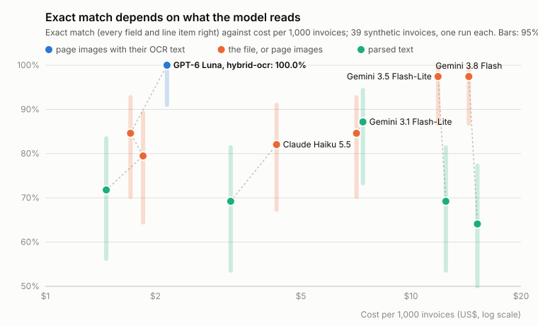

# Real-model benchmark

**Question.** Does it pay to parse a document on the CPU before an LLM reads it, rather than sending the PDF to the model? And what should the model be sent for each page?

**Answer, from these runs.** Sending less text saves little: output tokens are 72 to 92% of the cost, and Gemini and OpenAI read PDFs cheaply. Parsing pays off in accuracy on scanned pages, when the model gets the page image together with its OCR text (`hybrid-ocr`). With that input the cheapest API model tested, GPT-6 Luna, got 39 of 39 invoices exactly right for $2.15 per 1,000. The best PDF-reading setups, Gemini 3.5 Flash-Lite and 3.8 Flash, scored 97% at five to seven times the cost.



Each dot is one model on one route, over all 39 invoices. A line joins one model's results. The data behind the chart, every other run, and the samples it leaves out are in [`reports/e2e/`](../../reports/e2e/README.md). The chart and that index are generated from the reports by `docfunnel e2e-summary`, and a test fails if they drift.

## Setup

- **Documents.** 39 synthetic invoices, 174 pages. 29 small (1 to 4 pages, 17 to 170 line items) and 10 large (an invoice with contracts annexed, 8 to 10 pages). 10 are fully digital and 29 have at least one scanned page, light or heavy. They are generated by a seeded script, so the labels are right by construction (`docfunnel generate-pdfs && docfunnel generate-e2e`).
- **Score.** Exact match means every header field (vendor, tax ID, number, date, currency, subtotal, tax, total, payment method) and every line item is right. Field accuracy and line-item F1 are reported alongside.
- **Same everything else.** Every route uses the same prompt, the same JSON Schema output, one repair turn on invalid output, and the same scoring. Costs come from token counts and the [price table](../../src/docfunnel/extract/pricing.json).
- **Routes**, by what the model is sent:

  | Route in the reports | `route=` in the library | What the model reads |
  | --- | --- | --- |
  | `docfunnel` | `"text"` | the parse stage's text: the text layer, and OCR text on scanned pages |
  | `native` | `"native"` | the PDF file |
  | `hybrid` | `"hybrid"` | text-layer pages as text, and an image of each scanned page in its place |
  | `hybrid-ocr` | `"hybrid-ocr"` | `hybrid`, plus each scanned page's OCR text after its image |

## Results

All 39 invoices, single runs:

| Model | Route | Exact match | Field accuracy | Cost per 1k invoices |
| --- | --- | ---: | ---: | ---: |
| **GPT-6 Luna** | **hybrid-ocr** | **100%** (repeat on the 29 with scans: 97%) | **100%** | **$2.15** |
| GPT-6 Luna | native | 85% | 98.0% | $1.71 |
| GPT-6 Luna | docfunnel (text) | 72 to 74% | 100% | $1.47 to $1.68 |
| Gemini 3.5 Flash-Lite | native | 97% | 99.7% | $11.86 |
| Gemini 3.8 Flash | native | 97% | 100% | $14.40 |
| Gemini 3.1 Flash-Lite | docfunnel (text) | 87% | 99.1% | $7.39 |
| Claude Haiku 5.5 | native | 82% | 100% | $4.29 |
| Claude Haiku 5.5 | docfunnel (text) | 69% | 98.0% | $3.21 |

On smaller sets, each compared within its own run:

| Set | Model | Result |
| --- | --- | --- |
| 29 invoices with scans | Gemini 3.1 Flash-Lite, hybrid | 97% exact match at $6.99 per 1k |
| 12-invoice sample | Claude Haiku 5.5 at effort `medium`, hybrid | 100% at $4.39 per 1k |
| 12-invoice sample | Claude Sonnet 5.5, native or hybrid | 75% at $52 per 1k |
| 12-invoice sample | Gemma 4 12B on a laptop (Ollama), hybrid-ocr | 67% exact, 99% of header fields; docfunnel 58%, hybrid 33% |

## What the runs showed

1. **Text and images fail in different places.** With OCR text only, header fields were right and the misses were line items on scanned pages: OCR loses table rows. With page images only, line items were right, but GPT-6 Luna misread identifiers (tax IDs, document numbers, dates) on 3 to 8 invoices per run. With both, it got 39 of 39 right. A local Gemma 4 12B showed the same pattern: hybrid-ocr was its best route on every slice.
2. **Fewer input tokens are not where the money is.** The answer is: output is 72 to 92% of the cost, and it is mostly the line items' values. Sending parsed text instead of the PDF cut Claude Haiku's cost by 25% ($3.21 against $4.29 per 1,000), because Claude bills a PDF page as text plus an image. It saved nothing on Gemini or OpenAI.
3. **A bigger model did not help.** Gemini 3.8 Flash scored no better than 3.5 Flash-Lite at a higher price, and Claude Sonnet 5.5 did worse than Haiku on long invoices, at 12 times the cost.
4. **Business rules catch what the model drops.** The `line_items_missing` rule sent every answer with an empty item list to review. That is how a pipeline on the text route stays safe: the documents it cannot read well go to a person, not into the ledger.
5. **Tuning knobs mostly did not pay.** Reasoning effort `low` on GPT-6 Luna was within the noise for 12% more cost. Compact JSON keys saved few tokens. Haiku at effort `medium` did help on a 12-invoice sample.

How each of these was found, with every run and its cost: the [lab notebook](findings.md).

## Which route to use

| Your documents and constraints | Route | What to expect, from these runs |
| --- | --- | --- |
| Digital PDFs, text, e-mail bodies | `text` (the default) | Exact text from the text layer, no OCR. On Claude Haiku, 25% cheaper than sending the PDF. |
| Scans or mixed PDFs, with an API model that reads images | `hybrid-ocr` | The most accurate input measured: 100% and 97% on GPT-6 Luna, for about 25% more than sending the PDF ($2.15 against $1.71 per 1,000). |
| Documents that must not leave your machines | `hybrid-ocr` on a local model ([Ollama](../providers.md)) | Header fields 99% right on Gemma 4 12B, line items weaker: keep the review rules on. Minutes per document on a laptop. |
| A model that does not read images | `text` | OCR text for scanned pages; tables on heavy scans lose rows, and the rules send those to review. |
| Simplest integration, cost is secondary | `native` | Gemini Flash-Lite read the PDFs well (97%) at about $12 per 1,000. GPT-6 Luna and Claude Haiku did worse with the PDF than with `hybrid-ocr`. |

On a fully digital PDF, `text`, `hybrid` and `hybrid-ocr` send the same text. They differ only on the pages the parse stage sends to OCR, so `hybrid-ocr` costs nothing extra on digital documents.

## What these numbers do not show

- **Synthetic documents.** The scans are rendered and degraded by a script. Real scans (skew, stamps, handwriting, phone photos) are next: a CORD v2 subset is on the [roadmap](../roadmap.md).
- **Single runs.** Run-to-run variance was about 10 points of exact match on 29 documents. The hybrid-ocr result was repeated once (97%); others were not.
- **Not every model on every route.** `hybrid-ocr` was run on GPT-6 Luna and Gemma 4 only: the Anthropic and Gemini keys stopped working (revoked and out of credit) before it existed. Expect it to help Claude Haiku, whose hybrid misses were line items, but it is untested.
- **Prices from our table.** Costs are token counts times list prices checked on 2026-11-17, not provider invoices.

## Reproduce

Everything but the model calls runs offline. A full run of one model on all routes costs about $0.10 to $0.60 at the prices above.

```bash
uv sync --all-extras
uv run docfunnel generate-pdfs && uv run docfunnel generate-e2e     # 39 invoices, seeded

export OPENAI_API_KEY=...
uv run docfunnel eval-e2e -t openai:gpt-6-luna \
  --route docfunnel --route native --route hybrid --route hybrid-ocr \
  --budget-usd 1 --out reports/e2e-latest
```

- `--sample 12` or `--where scan=has_scanned_pages` gives cheaper subsets.
- `-t provider:model+option=value` sets a variant, e.g. `anthropic:claude-haiku-5-5+effort=medium`.
- `--budget-usd` caps spending per provider: calls past the cap are skipped and reported, never sent.
- A provider whose calls keep failing without using tokens (no credit, bad key) is stopped after three calls.

To add a run to the published results, move its folder to `reports/e2e/NN-name/` and run `uv run docfunnel e2e-summary` to regenerate the index and the chart.
